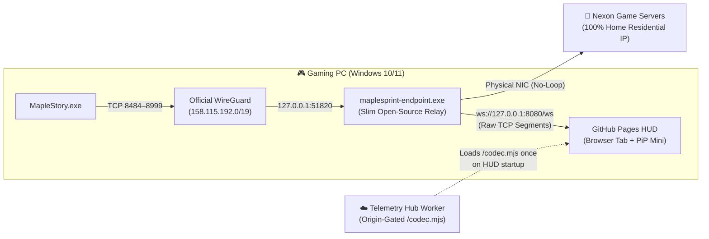

<div align="center">

# ⚡ MapleSprint HUD

**Real-time EXP/hr, Level ETA, Best Maps Guide, and Farming Splits for MapleStory Classic World**  
*Zero OCR · Zero Memory Hooks · 100% Home Residential IP · Open-Source Local Relay*

[](https://sdoolman.github.io/maplesprint-hud/)
[](https://github.com/sdoolman/maplesprint-hud/actions)
[](https://github.com/sdoolman/maplesprint-hud/releases)
[](LICENSE)

</div>

---

## ✨ How It Works

Unlike screen-scraping OCR overlays (`PrintWindow` / DXGI hooks) that misread digits, miss item drops, and trigger antivirus alerts, **MapleSprint** uses a clean split-tunnel + browser architecture:



- **100% Open-Source & Auditable Local Relay (`forwarder/`):** `maplesprint-endpoint.exe` is a tiny, dependency-light Go relay (`golang.org/x/net/websocket`) with **zero** embedded UI and **zero** proprietary game code. It binds strictly to `127.0.0.1:51820` and `127.0.0.1:8080` (zero UAC or Windows Firewall popups) and pins outbound sockets to your physical Wi-Fi/Ethernet NIC (`NewPhysicalNICDialer`) so traffic never loops back into WireGuard.
- **100% Home Residential IP & Game Stability:** Chrome is never in the critical game forwarding path — refreshing or closing the HUD tab never disconnects or lags `MapleStory.exe`.
- **Safe Worker-Loaded Browser Codec:** When you open the GitHub Pages HUD, it loads the packet decoder module (`/codec.mjs`) once from the Cloudflare Worker and decodes the local `ws://127.0.0.1:8080/ws` stream directly in browser memory at **0 ms latency**.

---

## 🚀 Quick Start (2 Minutes)

### 1️⃣ Start the Open-Source Local Endpoint
Download **`maplesprint-endpoint-windows-amd64.exe`** (Windows) or **`wg-forwarder-linux-amd64`** (Linux) from [**Releases**](https://github.com/sdoolman/maplesprint-hud/releases) and run it:

```powershell
# Windows (runs on 127.0.0.1:51820 & 127.0.0.1:8080 with zero Admin/Firewall prompts)
.\maplesprint-endpoint-windows-amd64.exe
```

### 2️⃣ Open the Unified Dashboard & HUD
Open [**sdoolman.github.io/maplesprint-hud**](https://sdoolman.github.io/maplesprint-hud/) in Chrome or Edge:
1. Click **`⚙ Endpoint`** in the top bar to open the **WireGuard + Local Endpoint Dashboard**.
2. Click **`⬇ MapleSprint.conf`**, import it into [**Official WireGuard**](https://www.wireguard.com/install/), and click **Activate**.
3. Click **`Connect Endpoint`** (or **`⧉ Mini`** to pop out the always-on-top Picture-in-Picture mini overlay) and start grinding!

---

## 🏆 Features

| Tab / Feature | What It Does |
|---|---|
| **⚙ Endpoint Dashboard** | Real-time status for **1. WireGuard Tunnel (`:51820`)**, **2. Local Endpoint Relay (`127.0.0.1:8080` + Physical Outbound IP)**, and **3. Cloudflare Worker Codec (`/codec.mjs`)**, plus 1-click `MapleSprint.conf` download. |
| **⚡ Live HUD & 15s Auto-Pause** | Tracks Session `EXP / HR` and **5-Minute Rolling `EXP / HR` (`5m: X/h`)**, automatically pausing active grind timers after 15 seconds of inactivity (`ACTIVE` / `PAUSED` badge). |
| **📈 Level `%`, `ETA` & Death Loss** | Uses the Classic World Level `1–200` EXP table (`CLASSIC_EXP_TABLE`) to compute exact level progress `%`, real-time `ETA` to next level, and negative Death EXP loss deltas. |
| **💰 Net Loot (`Mesos + NPC Value`)** | Automatically prices every dropped item using `items.json` NPC sell prices and adds it to your Meso/hr rate. |
| **⧉ Mini Overlay (Picture-in-Picture)** | One-click W3C Document Picture-in-Picture window that floats on top of the game showing live `EXP / HR`, `5m` rate, `Lv. %`, and `ETA`. |
| **🗺️ Best Maps Hunting Guide** | Ranks every hunting ground in `maps.json` + `monsters.json` for your exact **Level (`1–200`)** and **Class/Job** (`Warrior`, `I/L & F/P Magician`, `Cleric / Priest` Holy/Undead affinity, `Bowman`, `Thief`), blended with your own **Recorded `EXP / HR`**. |
| **📜 Map Log (Farming Splits)** | Automatically records a per-map farming split whenever you change maps (Active Time, EXP Gained, `EXP / HR`, Kills, Mesos, Drops), persisted to `localStorage` with 1-click JSON export. |

---

## 🛠️ Verification & CLI Options

```bash
node --check app.js
node --test verify.mjs
```

<details>
<summary>⚙️ Endpoint CLI Flags (`forwarder/main.go`)</summary>

- `--listen-udp` *(default `127.0.0.1:51820`)*: Localhost UDP address for unprivileged packet relay.
- `--http` *(default `127.0.0.1:8080`)*: Localhost API & WebSocket address for the GitHub Pages HUD.
- `--outbound-ip` *(default auto-detected)*: Physical LAN IPv4 address for no-loop outbound NIC binding.
- `--iface` *(default `wg0`)*: Tunnel interface to capture when running in Linux interface mode.
- `--sport-min` / `--sport-max` *(default `8484`–`8999`)*: Game TCP source port filter range.

</details>

---

## 🤝 Contributing & License

Pull requests for HUD improvements or open-source relay enhancements are welcome.  
Licensed under the [MIT License](LICENSE).
